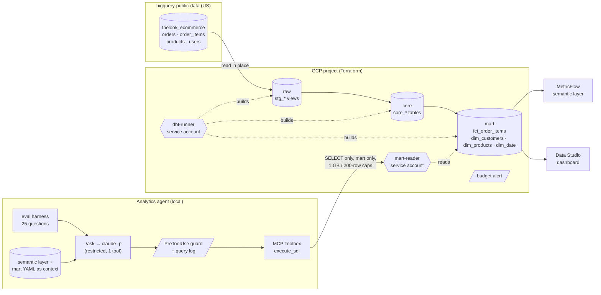

# thelook on BigQuery: dbt + MetricFlow + Data Studio + an AI analytics agent

A personal learning project: a small but complete analytics pipeline on Google Cloud, built to get hands-on with BigQuery, dbt, MetricFlow and Data Studio (formerly Looker Studio), with all infrastructure in Terraform. It also includes a small AI analytics agent that answers questions over the governed marts, and an eval harness that measures the agent's accuracy. It is deliberately minimal and not production-hardened.

Data: [`bigquery-public-data.thelook_ecommerce`](https://console.cloud.google.com/marketplace/product/bigquery-public-data/thelook-ecommerce), a synthetic e-commerce dataset (about 125k orders, 181k order items, 100k users, 29k products) that Google regenerates continuously.

## Architecture



## Stack

| Layer | Tool | Version |
|---|---|---|
| Infrastructure | Terraform, `hashicorp/google` provider | 1.17 / 7.x |
| Warehouse | BigQuery (US multi-region) | n/a |
| Transformation | dbt Core + dbt-bigquery | 1.12 |
| Semantic layer | MetricFlow (`dbt-metricflow`, Apache 2.0) | 0.213 |
| BI | Data Studio (formerly Looker Studio) | n/a |
| Agent runtime | Claude Code headless (`claude -p`), on a Claude subscription login | 2.1 |
| Agent ↔ BigQuery | [MCP Toolbox for Databases](https://github.com/googleapis/mcp-toolbox) (stdio) | 1.17 |

dbt Core v1 was chosen over the newer dbt v2 (Fusion) because open-source MetricFlow runs on dbt Core.

## Layer design

| Dataset | Layer | Materialisation | Contents |
|---|---|---|---|
| `raw` | Bronze | views | `stg_*`: renamed and typed 1:1 views over the public tables. Nothing is copied. PII (names, email, street address) is dropped here. |
| `core` | Silver | tables | `core_*`: conformed entities; order items enriched with order status, product cost and the net-revenue rule. |
| `mart` | Gold | tables, enforced contracts | Star schema: `fct_order_items` (grain: one order item), `dim_customers`, `dim_products`, `dim_date`. Plus `rpt_sales`, the star pre-joined into one wide table for BI. |

- **Dataset location:** all datasets are in `US` because BigQuery cannot join across locations, and the public dataset is in `US`.
- **Dataset names:** a `generate_schema_name` override writes models to the Terraform-managed datasets by name, instead of dbt's default `<target>_<schema>` prefixing.
- **Revenue rule:** `net_revenue` is `sale_price`, except for cancelled or returned items, which count as 0.
- **Time spine:** `dim_date` doubles as the MetricFlow time spine.

## Semantic layer

Defined in [`dbt/models/semantic/sem_sales.yml`](dbt/models/semantic/sem_sales.yml):

| Metric | Definition |
|---|---|
| `revenue` | sum of `net_revenue` |
| `orders` | count distinct `order_id` |
| `customers` | count distinct `customer_id` |
| `average_order_value` | ratio: `revenue / orders`. The denominator counts all orders, including fully cancelled or returned ones, so this is net revenue per order placed. |

Metrics can be sliced by `order_date`, `item_status`, `customer__country`, `customer__gender`, `customer__traffic_source`, `product__category`, `product__brand` and `product__department`.

Open-source MetricFlow compiles metrics to SQL locally (`mf query`). The hosted Semantic Layer APIs that BI tools connect to are a dbt platform feature, so Data Studio reads `rpt_sales` directly and re-creates the same four definitions as calculated fields (see [docs/looker-studio.md](docs/looker-studio.md)).

## Access model

- **No service account keys.** dbt authenticates with the developer's Application Default Credentials and impersonates the `dbt-runner` service account (`impersonate_service_account` in [`profiles.yml`](dbt/profiles.yml)). The only grant the developer has on the service account is `roles/iam.serviceAccountTokenCreator`.
- **`dbt-runner` is least privilege:**
  - `roles/bigquery.jobUser` at project level. This is the minimum needed to run queries, and it cannot be granted at dataset level.
  - `roles/bigquery.dataEditor` on the `raw`, `core` and `mart` datasets only.
  - Reading the public dataset needs no grant.
- **Cost guardrails:**
  - A Terraform-managed billing budget notifies billing admins at 50%, 90% and 100% of the monthly budget. It only notifies; it does not cap spend.
  - `maximum_bytes_billed: 1 GB` in the dbt profile makes any runaway query fail instead of billing.
  - A full `dbt build` bills roughly 100–150 MB, partly because BigQuery bills a 10 MB minimum for each table a query references. That is well inside the free tier (1 TB of queries per month).
- **`mart-reader` (used by the agent):** `roles/bigquery.dataViewer` on `mart` only, plus `roles/bigquery.jobUser`. It has no access to `raw` or `core` and cannot write anywhere. The developer impersonates it, so again no keys are involved. Like any principal with `jobUser`, it could still query public datasets such as `bigquery-public-data`. Keeping the agent to `mart` for those is done by Toolbox's `allowedDatasets`, not IAM.
- **Nothing sensitive is committed.** Terraform state, `*.tfvars`, agent query logs and `*.json` files are gitignored, apart from a few named config and eval files.

## Tests

`dbt build` runs 27 data tests:

- **Generic:**
  - `unique` and `not_null` on every primary key across the staging, core and mart layers.
  - `accepted_values` on item status.
  - `relationships` from the fact to all three dimensions, including `order_date → dim_date`.
- **Reconciliation:** [`assert_mart_revenue_reconciles_to_source`](dbt/tests/assert_mart_revenue_reconciles_to_source.sql) checks that the fact's row count and total `sale_price` exactly match the public source, to the cent. Because the source is regenerated continuously, the test compares only source rows up to the fact's latest timestamp.
  - It is mainly a fan-out and dropped-row check, and it is reliable within a single `dbt build`.
  - The staging layer is live views over a changing source, so if you run `dbt test` long after the build, newly generated rows can make this test and the `relationships` tests fail. Rebuild first.
- **Reporting table:** `assert_rpt_sales_matches_fact` checks that `rpt_sales` neither drops nor duplicates rows or revenue.
- **Model contracts:** contracts are enforced on the star-schema marts, so column names and types are checked at build time.
  - `not_null` constraints are enforced by BigQuery.
  - Primary keys are declared, but BigQuery does not enforce them; they are informational only and used by the optimizer. Uniqueness is covered by the `unique` tests.

## Analytics agent

`./ask "What was revenue by month in 2025?"` answers business questions in natural language by querying the mart layer. `./ask --chat` opens an interactive conversation with the same system prompt, tool and guardrails, so you can ask follow-up questions in one session.

A plain `claude` session in this folder can also use the BigQuery server from `.mcp.json`, and Toolbox and IAM still keep it read-only on `mart`. That session doesn't get the metric context, the guard hook or the query log, though, and it keeps Claude Code's other tools, including a shell running as you. Use `./ask` for the governed agent.

- **Runtime:** [`ask`](ask) runs Claude Code headless (`claude -p`) with a focused system prompt.
- **Data access:** the agent's only tool is BigQuery `execute_sql`, served by Google's MCP Toolbox for Databases. It is configured in the project's [`.mcp.json`](.mcp.json) and [`agent/tools.yaml`](agent/tools.yaml).
- **Context:** the system prompt ([`agent/system_prompt.md`](agent/system_prompt.md)) is built at run time from the dbt semantic layer and the mart YAML. The agent therefore uses the governed metric definitions (`revenue = SUM(net_revenue)`, and so on) rather than inventing its own logic, and the prompt can't drift from the dbt project.

### Guardrails (defence in depth)

| Layer | Control |
|---|---|
| IAM | `mart-reader` service account: read-only on `mart`, cannot read `raw`/`core`, cannot create tables |
| MCP Toolbox source | `readOnly: true` (SELECT only), `allowedDatasets: [mart]` (dry-run check), `maxQueryResultRows: 200`, `maximumBytesBilled: 1 GB` |
| Claude Code flags | `--restricted --tools ""` (no shell, file or web tools), `--strict-mcp-config` (only this MCP server), `--allowedTools mcp__bigquery__execute_sql`, `--permission-mode dontAsk` (everything else denied), no session persistence in one-shot and `--json` modes |
| PreToolUse hook | [`agent/hooks/guard_sql.py`](agent/hooks/guard_sql.py) is the audit log (every call goes to `agent/logs/queries.jsonl`) and a best-effort regex pre-filter that rejects non-SELECT, multi-statement and non-`mart` SQL. It fails closed: any error denies the call. |

IAM and MCP Toolbox are the layers that actually enforce access. The hook is a regex filter, not a SQL parser, so it is an extra check and the audit trail rather than the security boundary.

The system prompt also requires every reported number to come from an executed query.

### Runs on your own Claude subscription, not the API

The agent uses the Claude Code login on the machine running it (a Pro or Max subscription), so usage counts against that plan. There is no API key or API billing.
- `ask` and the eval runner exit immediately if `ANTHROPIC_API_KEY` (or `ANTHROPIC_AUTH_TOKEN`) is set.
- `ask` also exits if `claude auth status` reports a login other than a claude.ai subscription.
- `--bare` is not used.
- The JSON output includes a `total_cost_usd` field. On a subscription login this is a notional figure, not a charge.

**Anyone running this repo must use their own Claude login and their own GCP project and credentials.**

## Evaluation

[`eval/questions.yaml`](eval/questions.yaml) holds 25 questions across six categories, each with hand-written ground-truth SQL:
- simple lookups
- time filters
- breakdowns
- attribute filters
- comparisons
- tricky cases, such as gross versus net sales, and value lost to returns

The filter questions include one where the data spells the country differently from the question ("Brazil" is `Brasil`).

Expected answers live in [`eval/expected.json`](eval/expected.json). They are computed from the marts with `--refresh-expected`. Most questions use fixed periods (for example, 2024) so their answers stay stable. The five all-time questions change with every `dbt build`, so re-run `--refresh-expected` after rebuilding.

[`eval/run_eval.py`](eval/run_eval.py) works as follows:
- It runs each question through `./ask --json` in sequence, to go easy on plan limits.
- `--json-schema` constrains each answer to `{value, rows, sql}`.
- Answers pass if they are within 0.01% (or 1 cent) of the expected value. For breakdowns, the set of labels must also match (case-insensitive).
- It reports accuracy, results by category, failure categories and latency, in [`eval/results/`](eval/results).

| Run | Accuracy | Median / p90 latency | Failures |
|---|---|---|---|
| [baseline](eval/results/baseline.md) | 22/25 (88%) | 8.1 s / 51.7 s | 2 × `no_query_executed`, 1 × `no_answer` |
| [v2](eval/results/v2.md) | 25/25 (100%) | 7.3 s / 12.7 s | none |

What changed between the two runs, based on the baseline failures:
1. **Groundedness rule.** Twice, the agent wrote correct SQL but returned without executing it (`value: null`, zero queries logged). The prompt now requires every number to come from an executed query.
2. **Answer contract.** For "which month had the highest revenue?", the agent returned the amount but not the month. The schema now says that "which X" answers must include the label in `rows`, and that `value` is never null for a single-number answer.

Caveats:
- This is a small eval, written by the same person who built the agent, and each configuration was run once. LLM output is non-deterministic, so expect some variation between runs.
- The two baseline `no_query_executed` failures happened during an unusually slow start: the first few calls took 36–87 seconds against about 8 seconds afterwards. Part of the improvement may be due to that rather than the prompt change.
- The v1 prompt deliberately contained no eval-specific hints, such as the `Brasil` spelling.
- Both runs were scored with the current 0.01% tolerance. All passing answers were within 1 cent of the exact value.
- Mart column descriptions, which are part of the agent's context, were added after these runs. Re-run the eval to measure their effect.

## How to run

Prerequisites: a Google account with a billing account, plus `gcloud`, Terraform ≥ 1.9, and [uv](https://docs.astral.sh/uv/) (or another way to get Python 3.12).

```bash
# 1. Authenticate and create a project
gcloud auth login
gcloud auth application-default login
gcloud projects create <PROJECT_ID>
gcloud billing projects link <PROJECT_ID> --billing-account=<BILLING_ACCOUNT_ID>
gcloud config set project <PROJECT_ID>
gcloud services enable serviceusage.googleapis.com cloudresourcemanager.googleapis.com billingbudgets.googleapis.com
gcloud auth application-default set-quota-project <PROJECT_ID>

# 2. Infrastructure
cd terraform
cp terraform.tfvars.example terraform.tfvars   # fill in project, billing account, your email
terraform init && terraform apply
cd ..

# 3. dbt (IAM grants can take a few minutes to propagate before impersonation works)
uv venv --python 3.12 && uv pip install -r requirements.txt
source .venv/bin/activate
cd dbt
export GCP_PROJECT=<PROJECT_ID>
dbt debug
dbt build
dbt docs generate
dbt docs serve      # blocks this terminal; open a new one (venv active, GCP_PROJECT exported) for the next steps

# 4. Semantic layer
mf validate-configs
mf query --metrics revenue,orders,customers,average_order_value
mf query --metrics revenue,average_order_value --group-by product__category --order -revenue --limit 5
cd ..
```

Then build the dashboard by following [docs/looker-studio.md](docs/looker-studio.md).

Agent and evals (requires the [Claude Code](https://docs.claude.com/en/docs/claude-code) CLI, logged in with your own Claude subscription):

```bash
# from the repo root, with the venv active and GCP_PROJECT exported
unset ANTHROPIC_API_KEY             # ask refuses to run if it is set
agent/install-toolbox.sh            # pinned MCP Toolbox binary into ./bin (gitignored), MD5 integrity check
./ask "What were the top 5 product categories by revenue in 2025?"
./ask --chat                        # interactive, same guardrails (exit with Ctrl+D)

python eval/run_eval.py --refresh-expected   # after a new dbt build
python eval/run_eval.py --label myrun        # about 4 minutes for 25 questions
```

To tear everything down, run `terraform destroy`. This also deletes the dbt-built tables.

## Repository layout

```
terraform/        datasets, service account + IAM, budget alert
dbt/
  models/staging  raw layer: views over the public source
  models/core     core layer
  models/marts    star schema + contracts
  models/semantic MetricFlow semantic models and metrics
  tests/          reconciliation tests (source → fact, fact → rpt_sales)
  macros/         schema naming override
docs/             Data Studio walkthrough
ask               agent entry point (claude -p wrapper)
.mcp.json         project MCP config: BigQuery via MCP Toolbox
agent/            system prompt, Toolbox config, guard hook, settings, installer
eval/             questions + ground-truth SQL, expected answers, runner, results
```

## Licence

[MIT](LICENSE).
