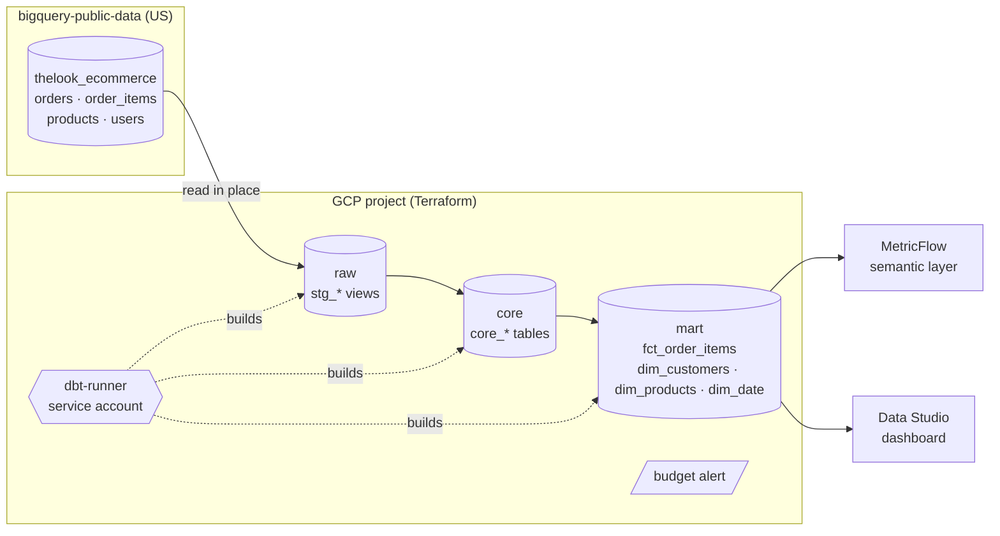

# thelook on BigQuery: dbt + MetricFlow + Data Studio

A personal learning project: a small but complete analytics pipeline on Google Cloud, built to get hands-on with BigQuery, dbt, MetricFlow and Data Studio (formerly Looker Studio), with all infrastructure in Terraform. It is deliberately minimal and not production-hardened.

Data: [`bigquery-public-data.thelook_ecommerce`](https://console.cloud.google.com/marketplace/product/bigquery-public-data/thelook-ecommerce), a synthetic e-commerce dataset (about 125k orders, 181k order items, 100k users, 29k products) that Google regenerates continuously.

## Architecture



## Stack

| Layer | Tool | Version |
|---|---|---|
| Infrastructure | Terraform, `hashicorp/google` provider | 1.17 / 7.x |
| Warehouse | BigQuery (US multi-region) | n/a |
| Transformation | dbt Core + dbt-bigquery | 1.12 |
| Semantic layer | MetricFlow (`dbt-metricflow`, Apache 2.0) | 0.213 |
| BI | Data Studio (formerly Looker Studio) | n/a |

dbt Core v1 was chosen over the newer dbt v2 (Fusion) because open-source MetricFlow runs on dbt Core.

## Layer design

| Dataset | Layer | Materialisation | Contents |
|---|---|---|---|
| `raw` | Bronze | views | `stg_*`: renamed and typed 1:1 views over the public tables. Nothing is copied. PII (names, email, street address) is dropped here. |
| `core` | Silver | tables | `core_*`: conformed entities; order items enriched with order status, product cost and the net-revenue rule. |
| `mart` | Gold | tables, enforced contracts | Star schema: `fct_order_items` (grain: one order item), `dim_customers`, `dim_products`, `dim_date`. Plus `rpt_sales`, the star pre-joined into one wide table for BI. |

- **Dataset location:** all datasets are in `US` because BigQuery cannot join across locations, and the public dataset is in `US`.
- **Dataset names:** a `generate_schema_name` override writes models to the Terraform-managed datasets by name, instead of dbt's default `<target>_<schema>` prefixing.
- **Revenue rule:** `net_revenue` is `sale_price`, except for cancelled or returned items, which count as 0.
- **Time spine:** `dim_date` doubles as the MetricFlow time spine.

## Semantic layer

Defined in [`dbt/models/semantic/sem_sales.yml`](dbt/models/semantic/sem_sales.yml):

| Metric | Definition |
|---|---|
| `revenue` | sum of `net_revenue` |
| `orders` | count distinct `order_id` |
| `customers` | count distinct `customer_id` |
| `average_order_value` | ratio: `revenue / orders` |

Metrics can be sliced by `order_date`, `item_status`, `customer__country`, `customer__gender`, `customer__traffic_source`, `product__category`, `product__brand` and `product__department`.

Open-source MetricFlow compiles metrics to SQL locally (`mf query`). The hosted Semantic Layer APIs that BI tools connect to are a dbt platform feature, so Data Studio reads `rpt_sales` directly and re-creates the same four definitions as calculated fields (see [docs/looker-studio.md](docs/looker-studio.md)).

## Access model

- **No service account keys.** dbt authenticates with the developer's Application Default Credentials and impersonates the `dbt-runner` service account (`impersonate_service_account` in [`profiles.yml`](dbt/profiles.yml)). The only grant the developer has on the service account is `roles/iam.serviceAccountTokenCreator`.
- **`dbt-runner` is least privilege:**
  - `roles/bigquery.jobUser` at project level. This is the minimum needed to run queries, and it cannot be granted at dataset level.
  - `roles/bigquery.dataEditor` on the `raw`, `core` and `mart` datasets only.
  - Reading the public dataset needs no grant.
- **Cost guardrails:**
  - A Terraform-managed billing budget notifies billing admins at 50%, 90% and 100% of the monthly budget. It only notifies; it does not cap spend.
  - `maximum_bytes_billed: 1 GB` in the dbt profile makes any runaway query fail instead of billing.
  - A full `dbt build` bills roughly 100–150 MB, partly because BigQuery bills a 10 MB minimum for each table a query references. That is well inside the free tier (1 TB of queries per month).
- **Nothing sensitive is committed.** Terraform state, `*.tfvars` and any `*.json` files are gitignored.

## Tests

`dbt build` runs 27 data tests:

- **Generic:**
  - `unique` and `not_null` on every primary key across the staging, core and mart layers.
  - `accepted_values` on item status.
  - `relationships` from the fact to all three dimensions, including `order_date → dim_date`.
- **Reconciliation:** [`assert_mart_revenue_reconciles_to_source`](dbt/tests/assert_mart_revenue_reconciles_to_source.sql) checks that the fact's row count and total `sale_price` exactly match the public source, to the cent. Because the source is regenerated continuously, the test compares only source rows up to the fact's latest timestamp.
- **Reporting table:** `assert_rpt_sales_matches_fact` checks that `rpt_sales` neither drops nor duplicates rows or revenue.
- **Model contracts:** contracts are enforced on the star-schema marts, so column names and types are checked at build time.
  - `not_null` constraints are enforced by BigQuery.
  - Primary keys are declared, but BigQuery does not enforce them; they are informational only and used by the optimizer. Uniqueness is covered by the `unique` tests.

## How to run

Prerequisites: a Google account with a billing account, plus `gcloud`, Terraform ≥ 1.9, and [uv](https://docs.astral.sh/uv/) (or another way to get Python 3.12).

```bash
# 1. Authenticate and create a project
gcloud auth login
gcloud auth application-default login
gcloud projects create <PROJECT_ID>
gcloud billing projects link <PROJECT_ID> --billing-account=<BILLING_ACCOUNT_ID>
gcloud config set project <PROJECT_ID>
gcloud services enable serviceusage.googleapis.com cloudresourcemanager.googleapis.com billingbudgets.googleapis.com
gcloud auth application-default set-quota-project <PROJECT_ID>

# 2. Infrastructure
cd terraform
cp terraform.tfvars.example terraform.tfvars   # fill in project, billing account, your email
terraform init && terraform apply
cd ..

# 3. dbt (IAM grants can take a few minutes to propagate before impersonation works)
uv venv --python 3.12 && uv pip install -r requirements.txt
source .venv/bin/activate
cd dbt
export GCP_PROJECT=<PROJECT_ID>
dbt debug
dbt build
dbt docs generate && dbt docs serve

# 4. Semantic layer
mf validate-configs
mf query --metrics revenue,orders,customers,average_order_value
mf query --metrics revenue,average_order_value --group-by product__category --order -revenue --limit 5
```

Then build the dashboard by following [docs/looker-studio.md](docs/looker-studio.md).

To tear everything down, run `terraform destroy`. This also deletes the dbt-built tables.

## Repository layout

```
terraform/        datasets, service account + IAM, budget alert
dbt/
  models/staging  raw layer: views over the public source
  models/core     core layer
  models/marts    star schema + contracts
  models/semantic MetricFlow semantic models and metrics
  tests/          reconciliation test
  macros/         schema naming override
docs/             Data Studio walkthrough
```
